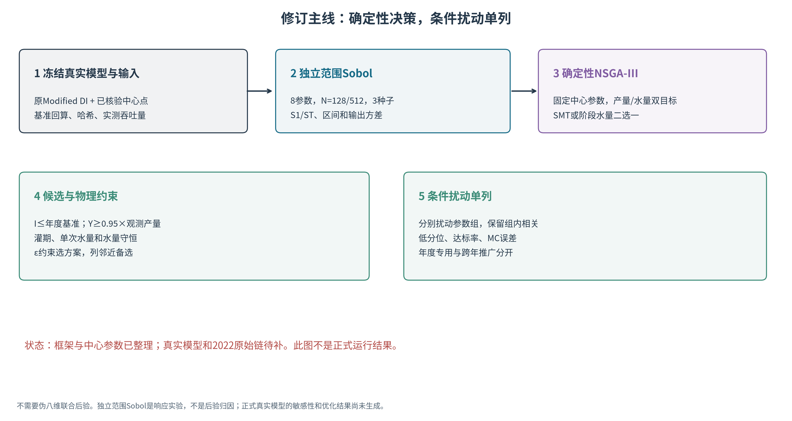
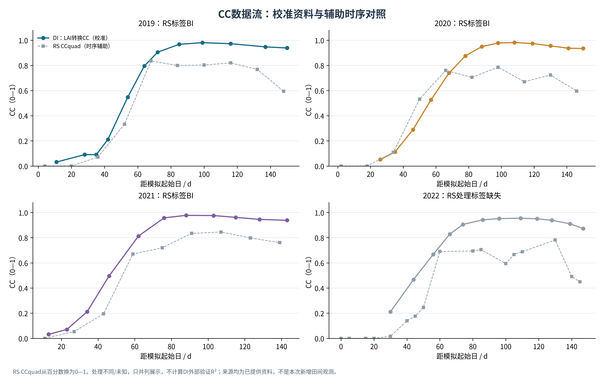
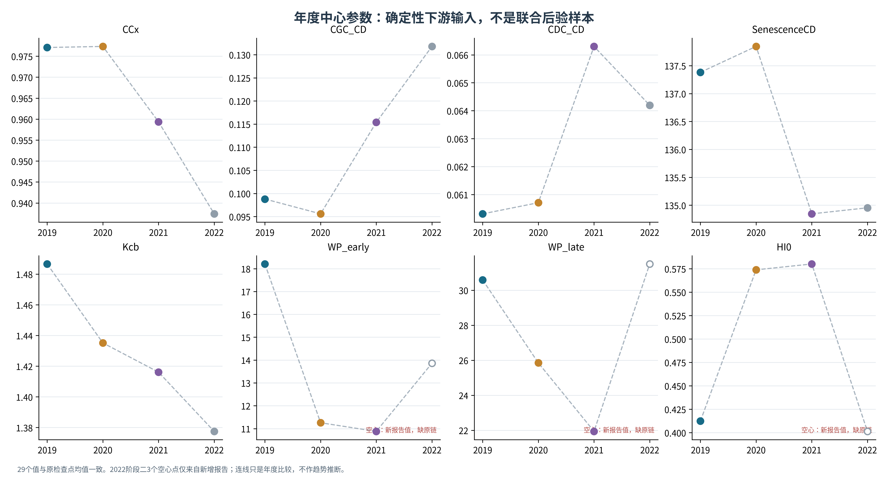
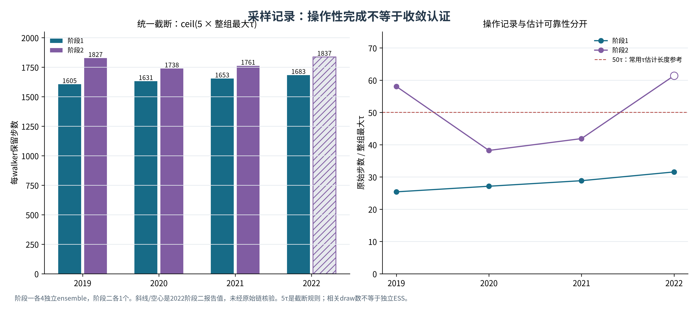
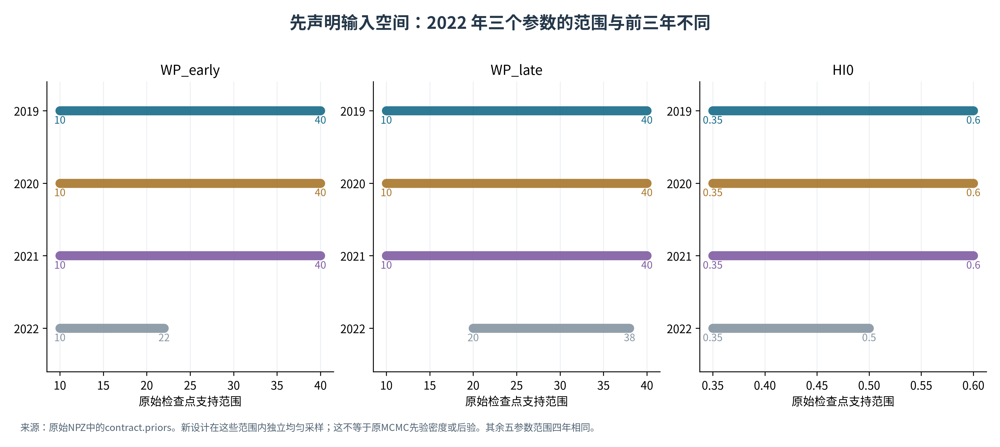
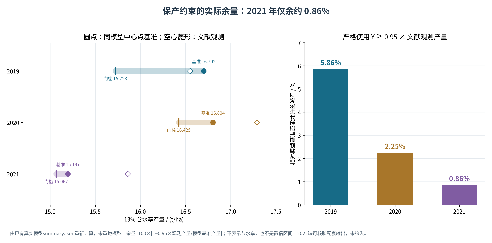
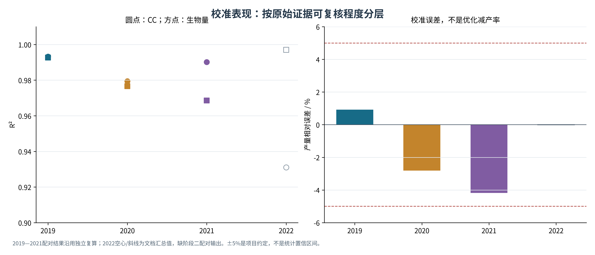
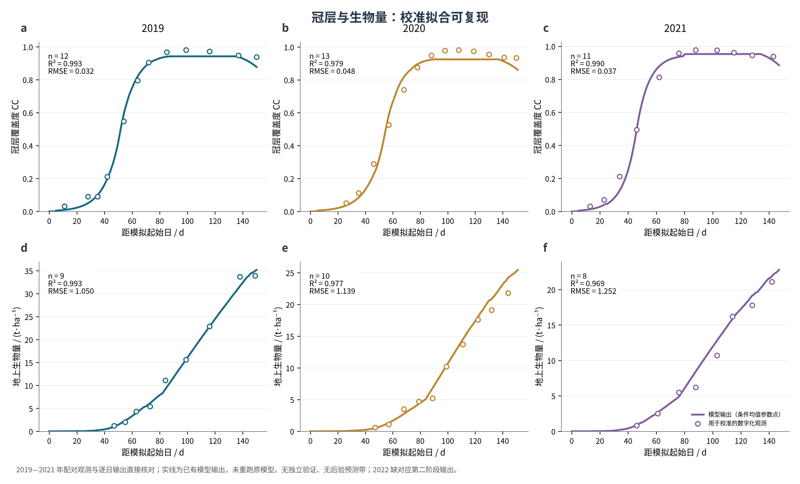
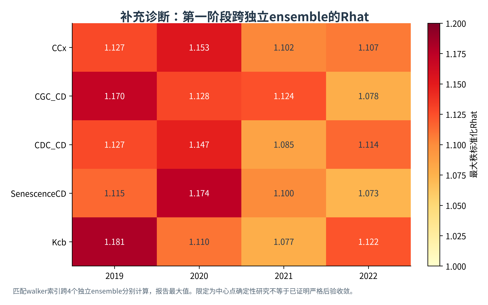

# 滴灌玉米改进AquaCrop的分阶段校准、独立范围敏感性与确定性灌溉优化
## 论文框架修订稿（2026-10-16，执行准备增补版）
定位：已核验的校准资料与确定性方法框架。正式真实模型Sobol和优化结果尚未生成。条件扰动是补充核验，不声称拥有八维联合后验。

## 摘要草稿
本研究整理2019—2022年滴灌玉米气象、冠层、作物及初始土壤水资料，构建分阶段条件校准与确定性灌溉决策框架。2019—2021已有配对输出可重现较好校准拟合；新增中心参数表中29个值与原始链均值吻合，2022阶段二仍待原始检查点交叉核验。后续拟在真实Modified DI模型中，以独立均匀物理范围开展Sobol响应分析，以年度中心参数驱动双目标NSGA-III，加入灌水、产量及过程物理约束，并单列条件参数扰动。当前证据支持样本内校准重现与内部数值一致性；正式敏感性排序、节水幅度和推广结论须在真实模型新运行后报告。
关键词：滴灌玉米；改进AquaCrop；条件校准；Sobol；确定性优化。

## 1 引言与研究问题
问题主线是如何从可解释的过程校准走向受约束、可执行的管理决策。MCMC、Sobol、NSGA-III是工具组合，本身不构成已证实的创新。
RQ1：分阶段校准后，模型在已有资料上能重现哪些过程？RQ2：指定独立参数范围内，哪些参数贡献输出方差？RQ3：固定年度中心点时，满足产量与水量约束的制度是什么？补充问题：候选在透明的组内条件扰动下是否稳定？
研究区、原始试验和文献来源应补自原始资料，不自行填入坐标、重复次数或试验设计。

图注：不需要伪八维联合后验。独立范围Sobol是响应实验，不是后验归因；正式真实模型的敏感性和优化结果尚未生成。

## 2 数据及其证据角色
| 数据 | 使用角色 | 限定 |
| --- | --- | --- |
| Field LAI-derived CC | 校准 | 原论文读图LAI再换算，非本次新增实测 |
| RS CCquad | 辅助时序 | BI或处理未知，不是DI外部验证 |
| 生物量、年产量 | 阶段二校准 | 保留读图误差、sigma假设与含水率 |
| Tr、Es | 过程约束 | Es近似；ET不重复作独立似然 |
| 初始土壤水 | 模型输入 | 分层读图/再分析来源需明示 |
| 灌溉日程 | 模型基准 | 不能称全部来自真实分次实测 |

图注：RS CCquad从百分数换为0—1。处理不同/未知，只并列展示，不计算DI外部验证R²；来源均为已提供资料，不是本次新增田间观测。

## 3 模型与分阶段条件校准
### 3.1 冻结真实Modified DI实现
区分标准AquaCrop与actual CC蒸发输入、真实MulchPct、两阶段WP和年度HI0的改进实现。正式适配器需返回Y13、B、Tr、Es、ET、灌溉量及逐日/季节水量残差；缺源码时不能声称已调用成功。
建议以标准模型、只改蒸发、只改两阶段WP、两处均改为结构消融对照，使用同一数据划分和预算；此比较尚未执行。样本内R²升高不能单独证明结构优越。
### 3.2 参数组与年度中心点
阶段一θ1=(CCx,CGC_CD,CDC_CD,SenescenceCD,Kcb)，阶段二θ2=(WP_early,WP_late,HI0)条件于阶段一代表点。两组均值拼成中心点是确定性输入，不是八维联合后验抽样。
表1 年度中心点。2022阶段二三个值仍为新报告值；原链待核。
| Year | CCx | CGC_CD | CDC_CD | SenescenceCD | Kcb | WP_early | WP_late | HI0 |
| --- | --- | --- | --- | --- | --- | --- | --- | --- |
| 2019 | 0.9771 | 0.0988 | 0.0603 | 137.3804 | 1.4866 | 18.2042 | 30.5848 | 0.4124 |
| 2020 | 0.9773 | 0.0956 | 0.0607 | 137.8440 | 1.4352 | 11.2550 | 25.8493 | 0.5738 |
| 2021 | 0.9594 | 0.1154 | 0.0663 | 134.8456 | 1.4161 | 10.8767 | 21.9376 | 0.5800 |
| 2022 | 0.9374 | 0.1318 | 0.0642 | 134.9539 | 1.3775 | 13.8601 | 31.4977 | 0.4013 |

图注：29个值与原检查点均值一致。2022阶段二3个空心点仅来自新增报告；连线只是年度比较，不作趋势推断。

### 3.3 操作记录与诊断
每组32 walkers、2000步；第一阶段4个独立ensemble，第二阶段1个。统一burn=ceil(5×整组最大tau)，所有参数共用整数截断。保留draw数仍含相关性。
| 年份 | 阶段 | 整组burn-in | 每walker保留步数 | 相关draw数 | 原链可核验 |
| --- | --- | --- | --- | --- | --- |
| 2019 | 1 | 395 | 1605 | 205440 | True |
| 2019 | 2 | 173 | 1827 | 58464 | True |
| 2020 | 1 | 369 | 1631 | 208768 | True |
| 2020 | 2 | 262 | 1738 | 55616 | True |
| 2021 | 1 | 347 | 1653 | 211584 | True |
| 2021 | 2 | 239 | 1761 | 56352 | True |
| 2022 | 1 | 317 | 1683 | 215424 | True |
| 2022 | 2 | 163 | 1837 | 58784 | False |

可以将研究限定为中心点确定性分析，无须宣称联合后验；仍应保留Rhat、ESS、tau估计及参数边界说明。5tau只是截断规则，不是独立的收敛证明。参考PDF尚未上传，当前不宣称已逐条核对其原文。

图注：阶段一各4独立ensemble，阶段二各1个。斜线/空心是2022阶段二报告值，未经原始链核验。5τ是截断规则；相关draw数不等于独立ESS。

### 3.4 校准评价
R²=1−SSE/SST；RMSE为均方误差平方根，Bias=mean(模拟−观测)。一年一对产量只报偏差。以同一批资料评价称校准拟合；不冒充外部验证。

## 4 独立范围Sobol的正式实施方案
主分析用8参数独立均匀物理范围，回答预声明空间的响应方差贡献，不是相关后验归因；全均匀试验也不等于原贝叶斯先验密度。物理范围需有文献或农艺来源，局部95%边际范围仅叫后验邻域响应实验。
先N128×3个scramble，必要时升512。不算二阶时调用数N(D+2)=10N；算二阶为18N。四年N128三种子共15360次真实调用，先计时再定预算。
保存输入空间、设计矩阵、逐次响应、S1/ST和bootstrap区间、输出均值方差与单位、失败点和种子。按年度比较排序，不用跨年均值代替年度结果，也不靠裁剪指数或强制排序美化结果。
**结果占位：真实模型尚未执行，暂不填写敏感性指数和正式排名，不沿用旧代理图代替。**

### 4.1 年度范围与输入概率密度
本轮从原始NPZ的contract.priors提取支持范围，各年度现有检查点之间一致。它们是历史校准的支持范围，农艺适用性仍需由来源解释，不因为写在代码里就自动成为物理定律。
| 参数 | 2019—2021范围 | 2022范围 |
| --- | --- | --- |
| CCx | [0.6, 0.99] | [0.6, 0.99] |
| CGC_CD | [0.08, 0.16] | [0.08, 0.16] |
| CDC_CD | [0.03, 0.12] | [0.03, 0.12] |
| SenescenceCD | [115, 145] | [115, 145] |
| Kcb | [1.05, 1.6] | [1.05, 1.6] |
| WP_early | [10, 40] | [10, 22] |
| WP_late | [10, 40] | [20, 38] |
| HI0 | [0.35, 0.6] | [0.35, 0.5] |

图注：前三年WP_early、WP_late均为10—40，HI0为0.35—0.60；2022分别为10—22、20—38、0.35—0.50。五个冠层/蒸腾参数支持范围一致。

旧脚本把2022也放在前三年的较宽范围内，改变了该年输入方差与可行参数空间。新的年度范围设计忠实记录原始支持，但四年Sobol差异会同时受气象、模型年度设置和范围变化影响，不能直接归因为气候。
若研究重点是控制输入空间后的跨年比较，应另外预声明共同范围，例如四年支持的交集，并让四年都在该空间重新运行；不能只从不同范围的结果中做气候归因。当前仅生成年度范围设计，没有生成或运行共同范围模型响应。
原MCMC在部分参数上含正态先验成分，2022含正态成分的参数更多。独立均匀设计与这些原先验、条件后验均不同，不再使用“后验Sobol”或“校准吸收率”解释本设计。

### 4.2 本轮已经生成的输入与尚未运行的响应
四年各3个scramble种子101、202、303，N=128、D=8、不算二阶，共12组设计、15360行。每个块按A、AB_1至AB_8、B固定顺序保存NPY和带row_id的CSV；设计与配置均有SHA256。相同种子扩大到N=512时，现有N128是前缀，可复用已有成功响应，仍需核对软件版本与输入哈希。
real_model_pipeline.py提供设计生成、基准复现、逐点调用、断点续算和S1/ST分析。模板因缺真实模型而明确失败。常量输出标记为不可辨识的归一化指数，未赋予伪零排名；缺点、重复行、非有限响应和水量不闭合均阻止分析。bootstrap区间只是给定设计的抽样区间，不涵盖模型结构或田间误差。
程序用Ishigami解析函数及合成软件夹具测试；没有将这些测试输出写成玉米模型响应。真实Sobol响应矩阵仍未生成。

## 5 确定性双目标NSGA-III的正式实施方案
### 5.1 管理变量
方案A为SMT1—SMT4，必须核对真实模块中百分比的定义、方向、根区和触发条件。方案B为四至五阶段水量、日期限定允许窗口。两者二选一；固定日期水量优化不写成日期优化。
### 5.2 目标与约束
固定年度中心参数，min(−Y13,I)。约束I≤年度DI模型基准；Y13≥0.95×文献观测产量；水量、灌期、非负量与守恒合格。同步报告相对同模型基准变化，防止混用观测、初始模拟与中心点模拟。
IWP=100×Y[t/ha]/I[mm]，单位kg/m³；产量统一13%含水率。零灌溉仅反事实，未经实测不得称验证情景。
### 5.3 预算、对照和选解
至少5种子、约100参考方向/种群、100代；双目标100个Das-Dennis方向可由99分割获得，不能照抄三目标配置。记录每代种群、目标和约束；加NSGA-II或参考方向敏感性对照。同年度同尺度使用固定HV参考点。
用ε约束选达产量阈值内最小水量，并列相邻备选；不自动称几何膝点。NSGA-III是算法名，不是只运行三代。约100×100×5×4=200000次候选调用，需先测实际耗时。
**结果占位：真实前沿、最终节水率、推荐日程未生成。旧2021约38%已撤回；新文档2.28%等亦缺原始运行响应，本轮不纳入已核验结论。**

### 5.4 观测门槛与模型基准必须同时报告
基准模型对2020、2021观测产量已有负偏差。优化时Y≥0.95×观测不能替换为Y≥0.95×模型基准，否则会叠加减产。例如2021的观测15.86、模型基准15.1971，绝对门槛应为15.0670，而不是14.4373 t/ha。
| 年份 | 文献观测 | 模型基准 | 95%绝对门槛 | 可减产余量_pct |
| --- | --- | --- | --- | --- |
| 2019 | 16.5500 | 16.7017 | 15.7225 | 5.8628 |
| 2020 | 17.2900 | 16.8040 | 16.4255 | 2.2527 |
| 2021 | 15.8600 | 15.1971 | 15.0670 | 0.8563 |

图注：由2019—2021原始summary.json的DI和Yield字段计算；本轮未重跑真实模型。2021可减产余量约0.1301 t/ha、相对模型基准0.8563%。这只限定产量空间，不给出任何节水潜力结论，也不能据此推断该年一定没有可行节水方案。
新候选应同时报告相对观测和相对同模型基准的变化，保留绝对门槛、总灌水上限与逐日/季节水量守恒。2022中心点验收仍需原阶段二链和配套模拟输出，不使用报告中的汇总数充当已验收基准。

## 6 条件扰动与适用范围
候选需真实模型回代。至少128组扰动是起始预算，仍要评估低分位和达标率的MC误差；样本数本身不保证可靠性。
分别扰动阶段一/固定阶段二中心，以及扰动阶段二整行样本/固定阶段一中心，保留组内相关。此为局部条件实验，不是完整联合传播。报告产量低分位、达标率、水量和守恒；这些概率只对应声明的条件分布，不是田间失收概率。
年度专用制度可逐年描述；推广到未知年份才需要留一年或嵌套跨年验证，不能用同四年既选制度又宣称外部验证。

## 7 现阶段可写的结果
### 7.1 校准表现
2019—2021配对输出可复算；2022只列新文档汇总值，尚未得到本轮配对输出核验。校准误差和优化减产率是不同量。
| 年份 | CC样本数 | CC_R2 | CC_RMSE | 生物量样本数 | 生物量_R2 | 生物量_RMSE | 观测产量 | 模拟产量 | 产量误差_pct | 证据 |
| --- | --- | --- | --- | --- | --- | --- | --- | --- | --- | --- |
| 2019 | 12 | 0.9932 | 0.0316 | 9.0000 | 0.9926 | 1.0498 | 16.5500 | 16.7017 | 0.9166 | 配对输出可复算 |
| 2020 | 13 | 0.9794 | 0.0482 | 10.0000 | 0.9766 | 1.1393 | 17.2900 | 16.8040 | -2.8107 | 配对输出可复算 |
| 2021 | 11 | 0.9902 | 0.0370 | 8.0000 | 0.9685 | 1.2520 | 15.8600 | 15.1971 | -4.1795 | 配对输出可复算 |
| 2022 | 12 | 0.9310 | 0.0600 | — | 0.9970 | 0.5560 | 14.0800 | 14.0800 | -0.0200 | 新文档汇总，缺配对输出 |

图注：2019—2021配对结果沿用独立复算；2022空心/斜线为文档汇总值，缺阶段二配对输出。±5%是项目约定，不是统计置信区间。

图注：据已有逐日输出和校准配对表；未重跑原模型，无新增外部验证。

### 7.2 中心参数一致性
29个中心值与原始保留均值一致。2022阶段二与实际源码仍缺原始可读文件。没有新证据证明所有参数严格多链收敛，应披露中心点近似的限制。
### 7.3 正式敏感性与管理结果
真实运行后再填：年度S1/ST/区间/输出方差，不同种子前沿与HV，基准和候选的产量/水量/IWP/储水变化，物理残差与ε约束方案、相邻备选、条件扰动。当前留空，不以旧代理数值顶替。

## 8 讨论与结论
讨论应区分：校准拟合与识别性，独立范围响应与后验归因，确定性方案与高可靠性，以及年度专用与未知年推广。数据读图、灌溉日程、纠偏ETo和模型结构限制都应明示。
现阶段结论可写：“已形成分阶段条件校准的年度中心参数和可复现记录；独立范围Sobol及受约束确定性优化在逻辑上不依赖伪联合后验，正式数值仍待真实模型执行。”不提前写最终敏感参数、平均节水与推广结论。

## 补充诊断与方法参考

图注：匹配walker索引跨4个独立ensemble分别计算，报告最大值。限定为中心点确定性研究不等于已证明严格后验收敛。

可核对FAO Irrigation and Drainage Paper 66；Goodman & Weare (2010), DOI 10.2140/camcos.2010.5.65；Vehtari et al. (2021), DOI 10.1214/20-BA1221；Saltelli et al. (2010), DOI 10.1016/j.cpc.2009.09.018；Deb & Jain (2014), DOI 10.1109/TEVC.2013.2281535。
本次具体参照论文仅有Windows路径和哈希，没有PDF原文，正式引用与设置仍待核。
