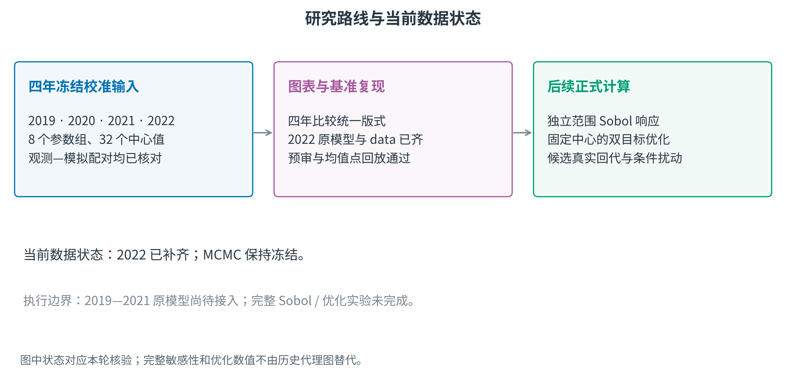
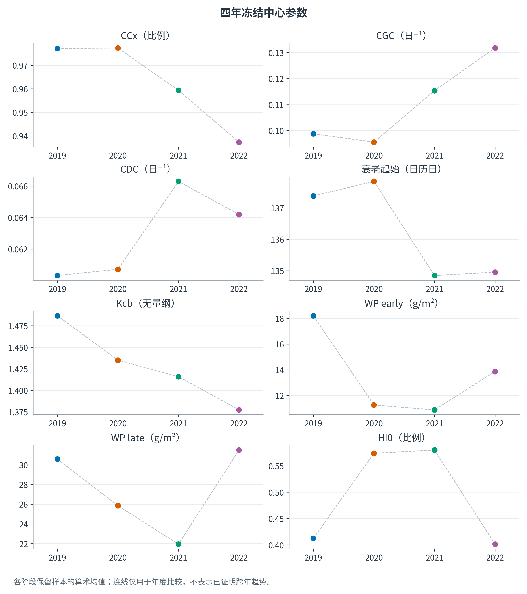
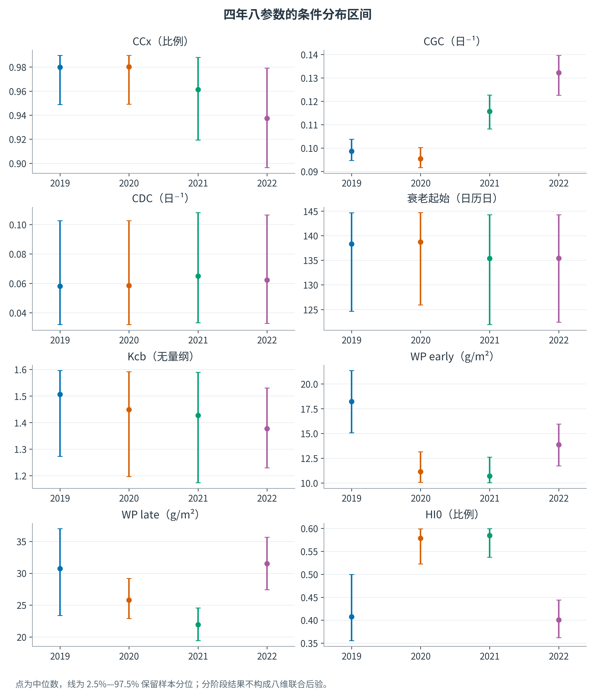
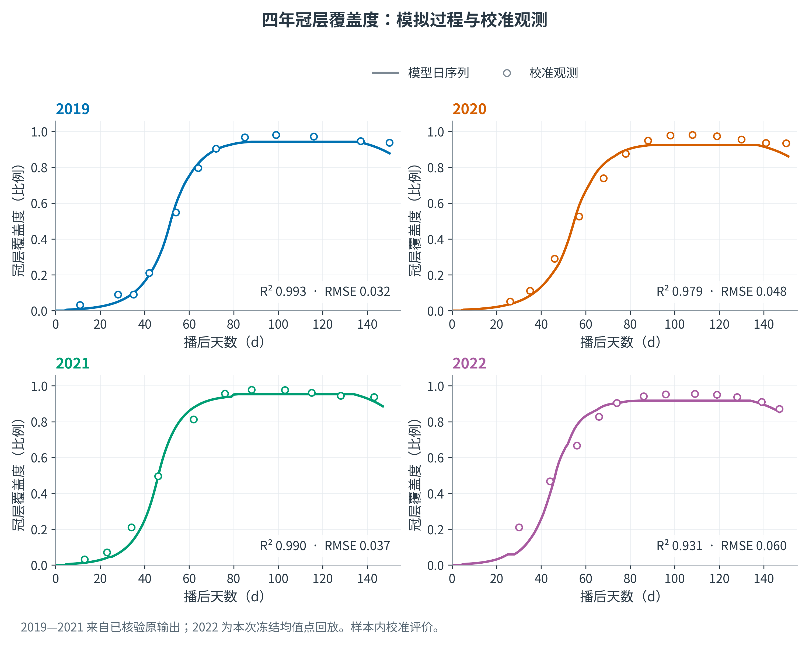
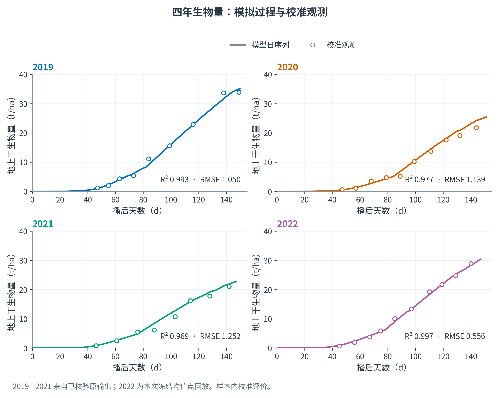
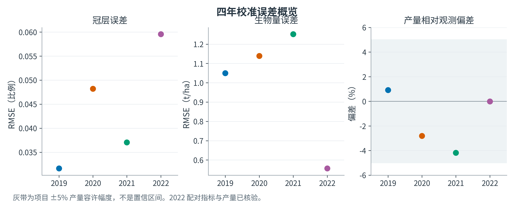
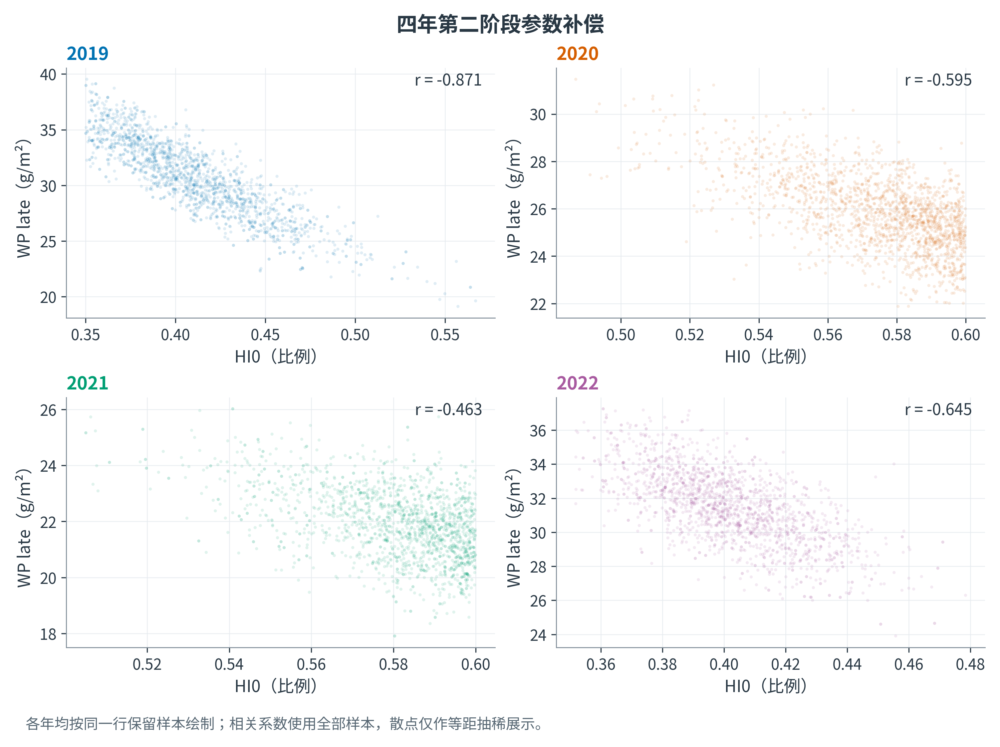
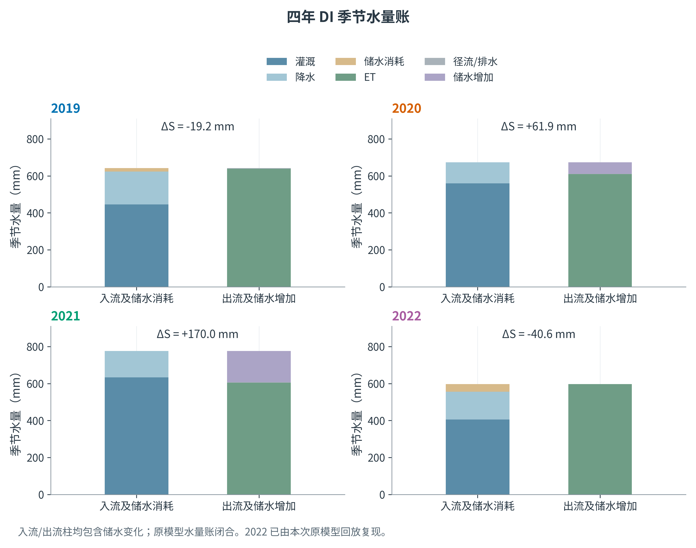
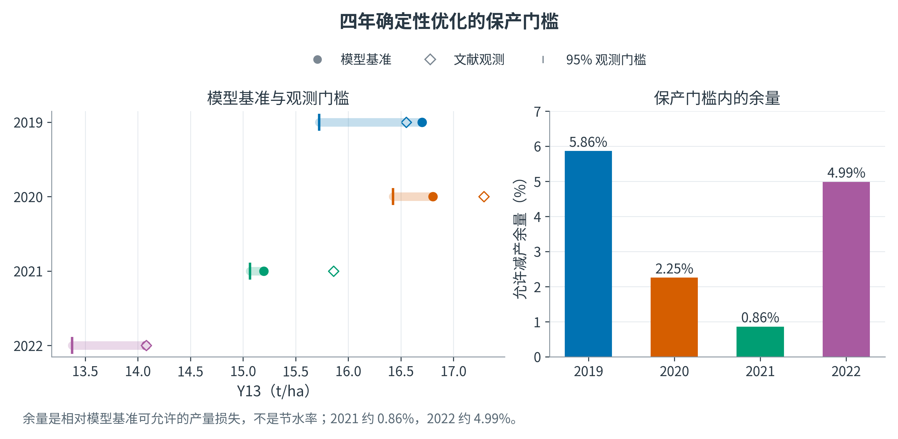

# 滴灌玉米改进 AquaCrop 的分阶段校准、范围敏感性与灌溉决策
## 四年数据与插图论文框架（2026-10-18 更新版）
本稿统一纳入2019、2020、2021、2022。图中四年分别为蓝、橙、绿、紫，字号与图例位置统一。2019—2021基于已核验的原始输出，2022增加了本轮原模型均值点回放；完整真实模型Sobol和优化实验尚未完成，相关结果保留待填。

## 摘要草稿
本研究以2019—2022年DI玉米的气象、冠层、生物量、产量和初始土壤水为基础，构建分阶段条件校准、独立范围敏感性和确定性灌溉决策框架。四年冠层与生物量配对序列均可复算，年度中心输入来自各阶段保留样本均值。2022年原模型与12份data原件已补齐，18项源文件哈希匹配，预审及DI/零灌溉均值点回放通过。后续将按预声明公共独立范围开展Sobol分析，并在固定年度中心点、产量与灌溉硬约束下开展双目标优化及候选条件扰动核验。现有结果属于样本内校准与数值复现，不提前报告正式敏感性排序、推荐制度或节水率。
关键词：滴灌玉米；改进AquaCrop；分阶段条件校准；Sobol；NSGA-III。

## 1 引言与研究问题
研究主线应围绕水分过程校准如何支持受供水与产量限制的管理决策，而不是把算法并列作为创新点。RQ1：四年资料支持哪些过程重现和参数补偿结论？RQ2：预声明独立物理范围下，哪些输入贡献输出方差？RQ3：固定年度中心点时，哪些非支配灌溉制度满足观测产量门槛，其条件参数扰动表现如何？
研究区、试验处理、田间重复数与测量误差仍须按原始论文和记录补齐，不能从拟合图推断试验设计。

图注：图中状态对应本轮核验；完整敏感性和优化数值不由历史代理图替代。

## 2 数据与模型复现
Field LAI转换的CC用于阶段一校准；地上干生物量和年产量用于阶段二条件校准。遥感CC为未进入似然的辅助时序，2019—2021处理为BI、2022标签不全，因此不称DI独立验证。ET=Tr+Es，派生ET核对不重复作为独立似然信息。
2022模型源码SHA256为31dc424301d544ca55cbdaf3f68a9b7c265feef2b66f3380f67121232fe954d5，与原阶段二合同一致；数据文件全部按原哈希核对。实际预审、冻结初始点及历史分组MAP复现通过。在阶段二均值点，本轮重算DI产量14.0777828181 t/ha、ET596.7846360647 mm；DI与零灌溉汇总和原记录差异均低于1.5×10^-14。阶段二均值输出不是后验预测均值。
当前工程已接入2022原模型；2019—2021的原始模型实现仍待接入。四年图表所用原输出与原件来源逐项记录，不能把重绘理解为本轮重新执行另外三年模型。

## 3 冻结分阶段校准与参数
阶段一为CCx、CGC_CD、CDC_CD、SenescenceCD、Kcb，阶段二为WP_early、WP_late、HI0。确定性分析采用年度两组保留样本的均值拼接；不把不同阶段、年度样本拼成八维联合后验。
每年阶段一4个独立ensemble，阶段二1个，每组32 walkers、2000步。采用组内最大τ的5倍向上取整截断；2022阶段二burn=163，保留1837步/每walker、58784行相关样本。原八个保留数组均保持冻结，不重跑MCMC。
严格阶段一Rhat/ESS限制在补充图S01单列，不将耦合walker视作独立链，也不宣称已认证联合收敛。确定性下游流程不因此强制新增联合后验门槛。

图注：各阶段保留样本的算术均值；连线仅用于年度比较，不表示已证明跨年趋势。

图注：点为中位数，线为 2.5%—97.5% 保留样本分位；分阶段结果不构成八维联合后验。

## 4 四年校准结果
### 4.1 冠层覆盖度
| 年份 | 配对数 | R2 | RMSE |
| --- | --- | --- | --- |
| 2019 | 12 | 0.9932 | 0.0316 |
| 2020 | 13 | 0.9794 | 0.0482 |
| 2021 | 11 | 0.9902 | 0.0370 |
| 2022 | 12 | 0.9306 | 0.0596 |

图注：2019—2021 来自已核验原输出；2022 为本次冻结均值点回放。样本内校准评价。

### 4.2 地上干生物量
| 年份 | 配对数 | R2 | RMSE_t_ha |
| --- | --- | --- | --- |
| 2019 | 9.0000 | 0.9926 | 1.0498 |
| 2020 | 10.0000 | 0.9766 | 1.1393 |
| 2021 | 8.0000 | 0.9685 | 1.2520 |
| 2022 | 10.0000 | 0.9966 | 0.5562 |

图注：2019—2021 来自已核验原输出；2022 为本次冻结均值点回放。样本内校准评价。

R²按1−SSE/SST计算，与Pearson相关平方分开；RMSE保留对应单位。2022冠层早期低估和2021生物量偏差应如实讨论，不通过平滑、删点或视觉缩放隐藏。四年散点配对图F04/F05另行提供。
### 4.3 年产量与误差
| 年份 | 观测产量 | 模拟产量 | 产量误差_pct |
| --- | --- | --- | --- |
| 2019 | 16.5500 | 16.7017 | 0.9166 |
| 2020 | 17.2900 | 16.8040 | -2.8107 |
| 2021 | 15.8600 | 15.1971 | -4.1795 |
| 2022 | 14.0800 | 14.0778 | -0.0157 |
每年仅一对年产量，单年产量R²不计算。±5%为项目容许幅度，不是统计置信带。上述指标为校准拟合，不是外部验证。

图注：灰带为项目 ±5% 产量容许幅度，不是置信区间。2022 配对指标与产量已核验。

## 5 参数补偿与水量过程
2022阶段二WP_late与HI0相关约−0.645；其他年度也存在补偿结构。后续条件扰动应保留同一阶段样本的整行相关，不用边际独立重抽代替。跨年参数差异可能吸收驱动误差、数字化误差及结构差异，不仅代表生理变化。

图注：各年均按同一行保留样本绘制；相关系数使用全部样本，散点仅作等距抽稀展示。

| 年份 | 灌水_mm | Tr_mm | Es_mm | ET_mm | 储水增加_mm |
| --- | --- | --- | --- | --- | --- |
| 2019 | 445.2700 | 540.7645 | 97.2337 | 637.9982 | -19.2272 |
| 2020 | 559.7600 | 526.7431 | 83.2188 | 609.9619 | 61.9190 |
| 2021 | 633.4700 | 533.2378 | 71.9055 | 605.1434 | 169.9674 |
| 2022 | 404.8400 | 529.9393 | 66.8453 | 596.7846 | -40.5824 |

图注：入流/出流柱均包含储水变化；原模型水量账闭合。2022 已由本次原模型回放复现。

完整量账包含灌溉、降水、CR、GwIn、ET、径流、深层渗漏、排水以及整个土壤与地表储水变化。季节残差约10^-12mm属于内部守恒证据。2022零灌溉产量5.8495800962 t/ha、相对DI减产约58.45%，仍是未经同地零灌溉观测验证的反事实。

## 6 Sobol 正式实验设计
八参数采用已声明公共物理范围内相互独立的均匀分布：CCx[0.60,0.99]、CGC[0.08,0.16]、CDC[0.03,0.12]、SenescenceCD[115,145]、Kcb[1.05,1.60]、WP early/late[10,40]、HI0[0.35,0.60]。这是指定范围的响应实验，不是原先验密度或条件后验传播，文献/农艺依据仍须在定稿时补全。
先N=128、三个scramble种子101/202/303，不算二阶时每年每种子1280次调用，四年共15360次；排序或区间不稳再扩大N=512。保存六输出Y13、Biomass、Tr、Es、ET、MaxCC，以及S1、ST、bootstrap区间、均值、方差、单位和输入—响应矩阵。常量输出标为归一化指数未定义；失败点不删行、不填零，不强制某参数排名第一。
local95仅作为边际邻域响应补充，不称posterior Sobol或计算CAI。现2022原模型可按工程中的--years 2022入口执行；完整实验尚未完成，本节不填历史代理指数。

## 7 确定性灌溉优化与候选核验
目标为min(-Y13,I)，固定年度中心参数。硬约束I≤年度DI基准、Y13≥0.95×文献观测；并检查非负量、原灌溉窗口和完整水量账。IWP=100Y[t/ha]/I[mm]，单位kg/m³。
| 年份 | 观测产量 | 模型基准 | 95%门槛 | 产量余量_pct |
| --- | --- | --- | --- | --- |
| 2019 | 16.5500 | 16.7017 | 15.7225 | 5.8628 |
| 2020 | 17.2900 | 16.8040 | 16.4255 | 2.2527 |
| 2021 | 15.8600 | 15.1971 | 15.0670 | 0.8563 |
| 2022 | 14.0800 | 14.0778 | 13.3760 | 4.9850 |

图注：余量是相对模型基准可允许的产量损失，不是节水率；2021 约 0.86%，2022 约 4.99%。

当前已提供2022接口支持原五个日期的阶段水量分配：06-09、06-22、07-03、07-24、08-09。它不提供SMT触发控制，因此采用指导文件允许的五阶段水量方案；该设置优化水量，不声称同时优化灌溉日期。
正式预算为约100个体/参考方向、100代、5种子，并与同预算NSGA-II对照。保存每代X/F/G/CV与统一归一化HV。以ε门槛内最低灌水量选主候选，另列两个相邻可行备选；无可行解时不输出推荐。
候选分别做阶段一扰动/固定阶段二、阶段二整行扰动/固定阶段一，每个可用组至少128行。报告均值、5%分位、观测门槛达标概率、MC误差、I/ET/Tr/Es和守恒。这是条件分布下的核验，不是八维联合传播或田间失收概率。
真实前沿、节水率与推荐日程仍待完整实验；旧代理图不用于本节结论，旧2021约38%节水不恢复。年度专用结果不自动外推为未知年通用制度。

## 8 讨论与定稿安排
讨论区分校准/验证、指定范围敏感性/后验归因、确定性最优/可靠性、年度定制/跨年泛化。保留数字化观测与假定sigma、近似Es目标、B组ETo、部分假定灌溉记录、模型结构与参数补偿等限制。
论文可按“数据与证据角色—冻结校准与基准复现—四年过程与参数—Sobol范围实验—双目标优化与条件核验—局限与适用条件”组织。正式敏感性表、前沿、算法对照和候选管理表在真实运行后插入，不提前填写。
图件当前统一18组PNG/PDF，所有年度比较均包含2019—2022。主图字号不小于10.5pt，年份颜色固定；补充S01保留严格诊断。旧代理探索归入历史目录。

## 参考方向
FAO Irrigation and Drainage Paper 66；Goodman与Weare（2010），DOI 10.2140/camcos.2010.5.65；Vehtari等（2021），DOI 10.1214/20-BA1221；Saltelli等（2010），DOI 10.1016/j.cpc.2009.09.018；Deb与Jain（2014），DOI 10.1109/TEVC.2013.2281535。具体试验资料、参考论文原文和引用页码仍须逐项核对。
