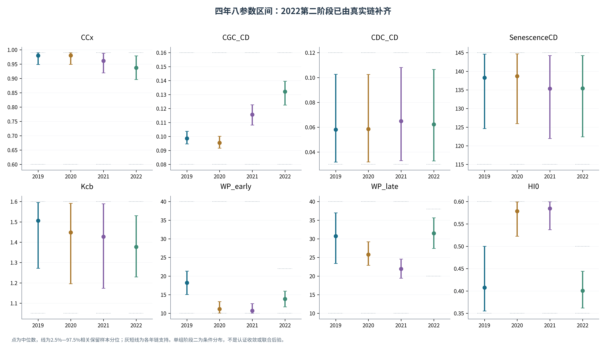
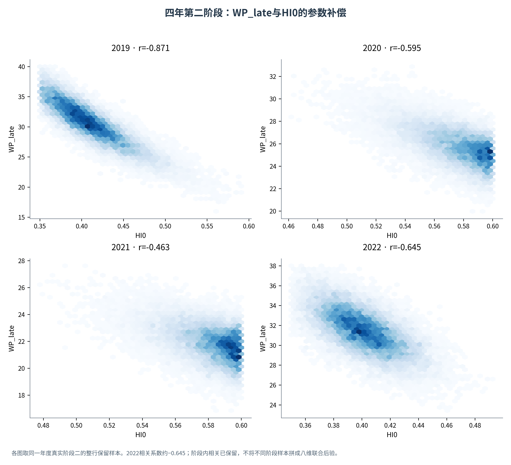
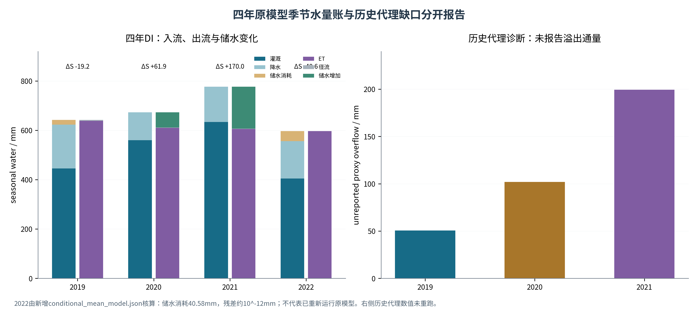

# 滴灌玉米改进AquaCrop的分阶段校准、全局范围敏感性与确定性灌溉优化
## 论文框架与数据插图更新稿（2026-10-17）
本稿已纳入2022真实第二阶段链及精确均值点输出。MCMC作为冻结输入；正式真实模型Sobol、NSGA-III及最终田间管理结论仍待原模型执行，不提前填写指数或节水幅度。

## 摘要草稿
本研究整理2019—2022年DI玉米气象、冠层、生物量、产量与土壤初始水资料，采用分组分阶段校准，并以年度参数中心点构建独立范围敏感性与确定性灌溉决策框架。现有配对资料支持2019—2021样本内校准评价；2022新补真实条件链包含2000步、32个walker，按5τ统一截断后保留58784行三参数样本，所报告均值和分位可由原始数组重建。四年32个中心值均已交叉核验，季节水量账内部闭合。后续拟在冻结Modified DI模型中开展公共独立均匀范围Sobol和受约束双目标NSGA-III，再单列候选的组内条件扰动。当前证据支持校准重现与数值一致性，正式敏感性排序、节水潜力与推广性须由真实模型新运行检验。
关键词：亏缺灌溉玉米；改进AquaCrop；分阶段条件校准；Sobol；NSGA-III。

## 1 引言与研究问题
研究问题是如何把可解释的作物水分过程校准用于受供水和产量限制的灌溉决策。工具组合本身不构成创新；需要明确新的过程认识或可执行决策依据。
RQ1：既有资料支持哪些样本内过程重现与参数补偿结论？RQ2：在预声明独立物理范围中，哪些参数贡献输出方差？RQ3：固定年度中心点时，满足水量和观测产量门槛的非支配制度是什么？补充问题是这些候选对分组条件参数扰动是否稳定。
研究区坐标、原始田间设计、重复数及测量误差应从原资料补齐，不凭结果图推断试验细节。

图注：2022正式阶段二链已补齐；真实模型原实现仍缺，未运行正式Sobol/NSGA-III。

## 2 数据、来源与证据角色
| 数据 | 用途 | 范围与限定 |
| --- | --- | --- |
| Field LAI-derived CC | 阶段一校准 | 论文数字化LAI再转换，非本次新增田间观测 |
| RS CCquad | 未进入似然的辅助时序 | 2019—2021为BI、2022处理标签缺失，不称DI外部验证 |
| Tr与Es | 阶段一过程约束 | 保留Es近似目标和数字化误差限定 |
| Biomass与年Yield | 阶段二条件校准 | 生物量与产量不是独立验证；产量为13%含水率 |
| ET | Tr+Es的派生核对 | 不重复作为独立似然信息计权 |
| 气象、土壤与灌溉 | 模型驱动/管理基准 | 纠偏、分层初始水和部分假定分次日程均须追溯 |

图注：RS不进入似然，但处理不同/未知，不是DI外部独立验证。2022补阶段二不会改变这项数据边界。

## 3 冻结模型与年度中心点
真实Modified DI保留actual CC蒸发、真实MulchPct、两阶段WP和年度HI0。原实现在当前材料中仍缺；新的一键脚本通过外部原项目加载模型，不能独立替代原源码。先对齐原基准点和随机管理点，再开展正式敏感性及优化。
阶段一θ1=(CCx,CGC_CD,CDC_CD,SenescenceCD,Kcb)，阶段二θ2=(WP_early,WP_late,HI0)条件于阶段一均值。两组均值拼接是确定性中心输入，不是八维联合后验样本。
| Year | CCx | CGC_CD | CDC_CD | SenescenceCD | Kcb | WP_early | WP_late | HI0 |
| --- | --- | --- | --- | --- | --- | --- | --- | --- |
| 2019 | 0.9771 | 0.0988 | 0.0603 | 137.3804 | 1.4866 | 18.2042 | 30.5848 | 0.4124 |
| 2020 | 0.9773 | 0.0956 | 0.0607 | 137.8440 | 1.4352 | 11.2550 | 25.8493 | 0.5738 |
| 2021 | 0.9594 | 0.1154 | 0.0663 | 134.8456 | 1.4161 | 10.8767 | 21.9376 | 0.5800 |
| 2022 | 0.9374 | 0.1318 | 0.0642 | 134.9539 | 1.3775 | 13.8601 | 31.4977 | 0.4013 |

图注：中心点数值未因本次补件改变。2022三个阶段二参数从“文档报告值”升级为“原检查点已核验”；连线只作年度比较。

四年第一阶段各4独立ensemble，阶段二各1个。每组32 walkers、2000步，burn=ceil(5×整组最大τ)，同组参数共用整数截断。
| 年份 | 阶段 | burn-in | 每walker保留步数 | 相关样本行数 |
| --- | --- | --- | --- | --- |
| 2019 | 1 | 395 | 1605 | 205440 |
| 2019 | 2 | 173 | 1827 | 58464 |
| 2020 | 1 | 369 | 1631 | 208768 |
| 2020 | 2 | 262 | 1738 | 55616 |
| 2021 | 1 | 347 | 1653 | 211584 |
| 2021 | 2 | 239 | 1761 | 56352 |
| 2022 | 1 | 317 | 1683 | 215424 |
| 2022 | 2 | 163 | 1837 | 58784 |

2022阶段二均值及区间现已由正式原链核验。源状态为SAMPLING_COMPLETE_REVIEW_REQUIRED；操作性完成不等于已认证严格收敛。原严格Rhat/ESS限制保留为补充诊断，不把耦合walker当独立链，也不为确定性下游流程新增联合后验要求。

## 4 Sobol：公共全局范围的真实模型响应实验
主分析采用公共预声明物理范围内相互独立的均匀分布。该设计回答指定范围下的方差贡献，既不是原MCMC先验密度，也不是条件后验传播；不同年度链支持只作参数结果解释，不自动替换主分析空间。
| 参数 | 全局公共范围 | 说明 |
| --- | --- | --- |
| CCx | 0.60—0.99 | 冠层上限 |
| CGC_CD | 0.08—0.16 | 日历日增长参数 |
| CDC_CD | 0.03—0.12 | 日历日衰减参数 |
| SenescenceCD | 115—145 | 衰老时序 |
| Kcb | 1.05—1.60 | 基础作物系数 |
| WP_early | 10—40 | 模型定义的前期归一化水分生产力 |
| WP_late | 10—40 | 模型定义的后期归一化水分生产力 |
| HI0 | 0.35—0.60 | 参考收获指数 |
范围沿用指导文件及既有工程的公共物理范围，投稿时仍需补农艺/文献依据。local95采用各年度真实保留样本的2.5%—97.5%边际范围，现2022也可读取，但仅叫邻域响应，不叫后验Sobol，不计算CAI。
先N=128、种子101/202/303，不算二阶时每年每种子N(D+2)=1280次；四年共15360次。若排名或区间不稳则升N=512，共61440次完整设计调用。六输出为Y13、Biomass、Tr、Es、ET、MaxCC。
主报告ST，同时报告S1、ST−S1、bootstrap区间、均值、方差、单位及Var(Y)×ST。不裁剪估计、不强制Kcb第一；常量输出标为归一化指数未定义。逐年比较，只有方向和区间足以支持时才称跨年稳健关键参数。
保存输入空间、哈希、种子、矩阵、每点响应、失败与状态；失败点不能删行或填零。**正式真实模型的指数及排名尚未计算，不从历史代理图填入。**

## 5 确定性双目标优化与候选条件核验
固定年度中心参数，min(-Y13,I)。优先真实模块的SMT1—SMT4、0—100%，核对百分比定义、根区、触发方向和窗口；不支持时采用4—5阶段水量与明确日期，两种体系不混合解释。
硬约束为I≤年度DI基准、Y13≥0.95×文献观测产量；同步报告相对同模型基准变化，检查非负水量、事件日期和完整水量账。IWP=100Y[t/ha]/I[mm]，单位kg/m³。
| 年份 | 文献观测 | 模型基准 | 95%绝对门槛 | 可减产余量_pct |
| --- | --- | --- | --- | --- |
| 2019 | 16.5500 | 16.7017 | 15.7225 | 5.8628 |
| 2020 | 17.2900 | 16.8040 | 16.4255 | 2.2527 |
| 2021 | 15.8600 | 15.1971 | 15.0670 | 0.8563 |
| 2022 | 14.0800 | 14.0778 | 13.3760 | 4.9850 |

图注：2022真实均值点产量14.077783 t/ha；允许减产约4.985%。2021仍仅约0.856%。这些是产量空间余量，不是节水率或置信区间。

2021的模型基准已低估观测约4.18%，因此继续相对模型基准再容许5%减产会放宽真实门槛。2022新精确基准距门槛余量约4.985%，这不是节水率。
NSGA-III采用100个双目标参考方向/种群、100代、5算法种子；默认与同预算NSGA-II比较，按年固定HV参考尺度。保存每代X/F/G/CV、目标、约束和前沿，不因结果不理想而只保留单次运行。
推荐为ε门槛内最低灌水量，并列两个相邻可行备选；无可行解则明确无推荐，不回退最高产量。最终候选必须以同一真实模型回代，不能用绘图插值得到新可行点。
候选分别扰动阶段一/固定阶段二中心、扰动阶段二整行样本/固定阶段一中心，每个可用组至少128行，保留组内相关；2022两个组现均有真实样本。报告均值、5%分位、绝对观测门槛概率、MC误差、灌水/通量/守恒。这是声明分布下的条件核验，不是八维联合传播或田间失收概率。
年度专用方案可逐年优化；若要声称未知年通用制度，需留一年/嵌套检验，不用同四年同时选解和验证。**真实前沿、节水率和推荐日程尚未生成；旧2021约38%仍撤回。**

## 6 现阶段可写入论文的结果
### 6.1 校准指标与证据分层
| 年份 | CC_R2 | CC_RMSE | 生物量_R2 | 生物量_RMSE | 观测产量 | 模拟产量 | 产量误差_pct |
| --- | --- | --- | --- | --- | --- | --- | --- |
| 2019 | 0.9932 | 0.0316 | 0.9926 | 1.0498 | 16.5500 | 16.7017 | 0.9166 |
| 2020 | 0.9794 | 0.0482 | 0.9766 | 1.1393 | 17.2900 | 16.8040 | -2.8107 |
| 2021 | 0.9902 | 0.0370 | 0.9685 | 1.2520 | 15.8600 | 15.1971 | -4.1795 |
| 2022 | 0.9310 | 0.0596 | 0.9970 | 0.5562 | 14.0800 | 14.0778 | -0.0157 |

2019—2021的配对评价沿用此前独立复算。2022 RMSE和产量现有精确JSON支持；R²=0.931/0.997仍为Word汇总值，缺少配对序列，不能声称本轮逐点重算。年产量每年一对，不计算单年产量相关系数。±5%是项目容许幅度，不是统计置信带。

图注：2022空心R²仍为原Word中的汇总值，未从配对表重算；产量偏差与RMSE已更新为新JSON精确值。±5%为项目容许幅度。

### 6.2 参数区间与补偿

图注：点为中位数，线为2.5%—97.5%相关保留样本分位；灰短线为各年链支持。单组阶段二为条件分布，不是认证收敛或联合后验。

图注：各图取同一年度真实阶段二的整行保留样本。2022相关系数约−0.645；阶段内相关已保留，不将不同阶段样本拼成八维联合后验。

2022的WP_late—HI0相关约−0.645，说明阶段二组内仍有补偿结构。该关系来自同一行真实样本，不应通过边际独立重抽打散；也不能凭较窄区间证明因果识别或完整联合后验收敛。
### 6.3 新增真实链及水量账

图注：仅使用正式2000步检查点，2步smoke排除。5τ截断与τ长度参考不是独立多链收敛认证；未把32个walker当作32条独立链计算Rhat。

| 年份 | 灌溉_mm | 降水_mm | Tr_mm | Es_mm | ET_mm | 储水增加_mm |
| --- | --- | --- | --- | --- | --- | --- |
| 2019 | 445.2700 | 177.8688 | 540.7645 | 97.2337 | 637.9982 | -19.2272 |
| 2020 | 559.7600 | 113.4648 | 526.7431 | 83.2188 | 609.9619 | 61.9190 |
| 2021 | 633.4700 | 143.3228 | 533.2378 | 71.9055 | 605.1434 | 169.9674 |
| 2022 | 404.8400 | 151.3838 | 529.9393 | 66.8453 | 596.7846 | -40.5824 |

图注：2022由新增conditional_mean_model.json核算：储水消耗40.58mm，残差约10^-12mm；不代表已重新运行原模型。右侧历史代理数值未重跑。

四年季节水量残差约10^-12mm是内部守恒证据，不替代真实通量验证。2021储水增加约169.97mm；2022消耗40.58mm。2022零灌溉给出的约58.45%减产仍为未验证反事实。
### 6.4 待真实模型填入的敏感性与管理结果
填写年度S1/ST与区间、输出方差、不同种子前沿和HV、算法对照、基准/候选产量及水量/IWP/储水变化、ε备选、条件概率与低分位。历史代理结果只在审计附录中注明版本和局限，不替代本节。

## 7 讨论、限制与结论边界
讨论应区分样本内校准与外部验证、公共独立范围响应与后验归因、确定性最优与可靠性，以及年度专用与未知年推广。数字化资料、部分假定灌溉、近似Es、纠偏ETo和模型结构误差应透明披露。
本轮可得结论是：四年分阶段原链和年度中心输入已具备完整的可追溯记录；2022条件分布与均值点量账得到交叉核验。正式敏感性和受约束灌溉优化在研究逻辑上不需要虚构八维联合后验，但最终数值仍须真实Modified DI执行。

## 补充材料与方法参考
提交原始/保留数组形状、20组检查点哈希、2022核验记录、参数区间与阶段内相关、严格阶段一诊断、输入空间与执行状态、软件测试及历史代理说明。原模型缺件与参考PDF未提供分别说明，不把软件测试当作作物验证。
参考方向可核对FAO Irrigation and Drainage Paper 66；Goodman与Weare（2010），DOI 10.2140/camcos.2010.5.65；Vehtari等（2021），DOI 10.1214/20-BA1221；Saltelli等（2010），DOI 10.1016/j.cpc.2009.09.018；Deb与Jain（2014），DOI 10.1109/TEVC.2013.2281535。用户参照论文目前仅有路径和哈希，具体原文引用仍待核。
