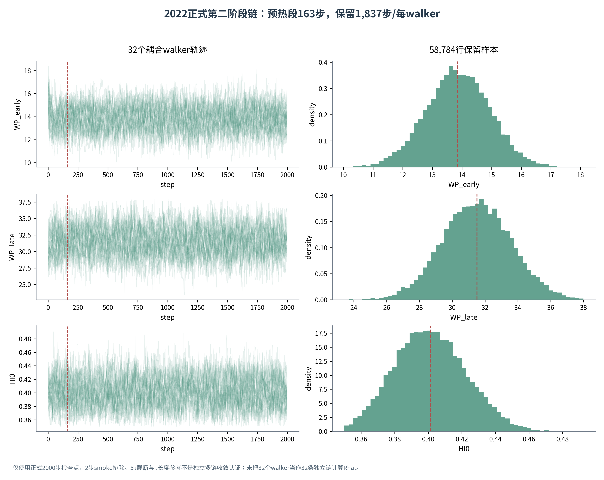

# URP六包更新与2022第二阶段核验报告
版本：2026-10-17。新增原件：DI_2022_Phase2.zip。更新对象：此前六个GitHub交付压缩包及对应代码、论文、图表。

## 1 本轮结论与范围
2022第二阶段真实检查点已补齐并通过数组、状态、元数据与摘要交叉核验。四年现在有16组阶段一和4组阶段二原链记录；当前统一保留样本文件从7个数组扩为8个。原有7个数组逐值不变，新加入p2_2022为58784×3。
32个年度中心参数均可追溯到原链保留均值，2022三个阶段二中心值与上版文档值一致，因此确定性中心点没有改动；新增的是可核验的分布、相关结构和精确模型汇总。
没有重新运行MCMC，也没有执行正式真实模型Sobol或NSGA-III。新包内的9KB一键脚本明确依赖外部DI_2022_MCMC_ONE_CLICK.py与原data目录；这些原实现仍未交付。本轮不把衔接脚本误当完整模型。

## 2 正式链核验
仅使用phase2_conditional_results/checkpoints/biomass_yield/ensemble_1.npz。phase2_smoke中的2步检查点排除出统计；上传原ZIP原样保留，方便审计。
形状2000×32×3，history与logs均为有限值，position/logp与链末状态一致。accepted数组的平均接受率为0.647625。四份阶段一检查点的哈希引用与既有核验表一致，固定点与阶段一保留均值逐值相同，包装脚本哈希与contract.wrapper_sha256相符。
积分自相关时间依次为30.394338、31.461506、32.580007；统一burn=ceil(5×maxτ)=163。每walker保留1837步，32×1837=58784行相关样本。2000/maxτ约61.387，满足包内50τ长度参考，但不等于独立多链收敛认证。
| Parameter | N | Mean | SD | P025 | Median | P975 |
| --- | --- | --- | --- | --- | --- | --- |
| WP_early | 58784 | 13.8601 | 1.0702 | 11.7168 | 13.8606 | 15.9396 |
| WP_late | 58784 | 31.4977 | 2.0933 | 27.4009 | 31.4964 | 35.6407 |
| HI0 | 58784 | 0.4013 | 0.0212 | 0.3618 | 0.4006 | 0.4440 |

均值、样本标准差及2.5%/50%/97.5%分位均与新增JSON在数值容差内一致，所有保留参数在各自声明支持内。单ensemble不计算把32个耦合walker当独立链的Rhat；源状态仍为SAMPLING_COMPLETE_REVIEW_REQUIRED，Inference_validated=false。

图注：仅使用正式2000步检查点，2步smoke排除。5τ截断与τ长度参考不是独立多链收敛认证；未把32个walker当作32条独立链计算Rhat。

## 3 模型汇总与水量核算
新增conditional_mean_model.json给出均值参数点的DI和零灌溉输出，不是后验预测均值。本轮重新核对Y_dry=0.87Y13、ET=Tr+Es、完整土壤/地表储水与通量账，未重跑原模拟器。
DI产量为14.0777828181 t/ha，相对文献14.08的误差约−0.01575%；灌水404.84mm，Tr=529.939343mm，Es=66.845293mm，ET=596.784636mm，储水消耗40.582409mm。IWP=100Y/I=3.477370 kg/m³。
零灌溉产量为5.8495800962 t/ha，相对DI损失58.4481%，仍是未经同地实测验证的反事实。季节量账重算残差均约10^-12mm。
2022 CC_RMSE=0.0595741682、生物量RMSE=0.5561588827来自本次JSON；缺少对应逐日及配对表，因此R²=0.931/0.997仍按先前Word报告值标注，不升级为本轮配对复算。
| 年份 | 灌溉_mm | 降水_mm | Tr_mm | Es_mm | ET_mm | 储水增加_mm |
| --- | --- | --- | --- | --- | --- | --- |
| 2019 | 445.2700 | 177.8688 | 540.7645 | 97.2337 | 637.9982 | -19.2272 |
| 2020 | 559.7600 | 113.4648 | 526.7431 | 83.2188 | 609.9619 | 61.9190 |
| 2021 | 633.4700 | 143.3228 | 533.2378 | 71.9055 | 605.1434 | 169.9674 |
| 2022 | 404.8400 | 151.3838 | 529.9393 | 66.8453 | 596.7846 | -40.5824 |

## 4 六个包同步更新内容
完整报告包：四年参数统计、20组检查点清单、更新论文/审查报告/工作簿/图册、当前工程和原始补件。
运行结果包：新增真实阶段二保留样本、核验日志/表、相关图与当前状态。上版36组Sobol和9次优化仍标为2026-10-15历史代理探索，没有冒充新运行。
图件包：补齐四年区间、阶段二相关、水量与门槛，新增2022轨迹/分布图；历史代理图均有显式历史标题。
新增材料复核包：32个中心值均核验、8组参数组均可追溯；论文/采样表不再写2022原链缺失。
计算准备包：2022基准从四舍五入报告值改为精确JSON，四年全局公共范围设计重新生成并绑定新配置哈希。
Sobol与优化工程包：统一样本新增p2_2022，local95和128组阶段二条件扰动已可读取，新增回归测试；主分析继续遵照三份指导文件，不改为年度链范围默认采样。

## 5 当前研究方案与保留边界
MCMC保持冻结的分阶段条件推断。主Sobol为预声明公共物理范围内独立均匀输入，N128×3个scramble、不算二阶，必要时升N512，报告六输出的S1/ST/区间/均值/方差/单位。local95是可选邻域响应，不叫后验Sobol，不计算CAI。
主优化固定年度中心点，min(-Y13,I)，I≤年度DI基准且Y13≥0.95×文献观测。优先真实SMT1—4；否则4—5阶段水量和明确日期窗口。100方向/种群、100代、5种子，默认同预算NSGA-II对照；候选以ε约束选解，回代并分别用两个参数组至少128行扰动核验。
| 年份 | 文献观测 | 模型基准 | 95%绝对门槛 | 可减产余量_pct |
| --- | --- | --- | --- | --- |
| 2019 | 16.5500 | 16.7017 | 15.7225 | 5.8628 |
| 2020 | 17.2900 | 16.8040 | 16.4255 | 2.2527 |
| 2021 | 15.8600 | 15.1971 | 15.0670 | 0.8563 |
| 2022 | 14.0800 | 14.0778 | 13.3760 | 4.9850 |

2021产量余量仍仅0.8563%，2022约4.9850%，这些不是节水率。真实模型前沿、最终节水与可执行日程仍没有新计算证据，不能恢复旧2021约38%结论。
旧代理图和CSV只保留历史审计用途；真实2022链补齐不会把原代理的1500个人造输入、旧阈值或旧结果追溯性地变成真实模型分析。

## 6 历史问题的当前状态
| ID | Finding | Current_status | Action |
| --- | --- | --- | --- |
| A01 | 历史原代理使用2022构造样本；当前真链已补齐 | 已补齐当前真链 | 本轮接入真实2000×32×3检查点，旧1500行构造值仅保留在历史代理记录，不能混入当前数据 |
| A02 | 后续分析使用自写代理而非原改进模型 | 历史诊断仍适用，正式结果需真实模型核验 | 补含两阶段 WP 与蒸发结构修改的原模型；统一接口核验基准点和随机管理点，再复算候选方案 |
| A03 | 独立冠层验证存在数据复用 | 历史诊断仍适用，正式结果需真实模型核验 | 改称样本内校准；独立年份、处理或地块留出，任何校准都不能看测试资料 |
| A04 | 第一阶段尚未满足收敛标准 | 诊断限制保留 | MCMC作为冻结输入；严格诊断置于补充说明，不作为确定性主流程新增门槛，不声称认证收敛 |
| A05 | 两阶段条件分布不能拼成联合后验 | 主线按指导已调整 | 年度均值用于确定性分析；两个参数组分别扰动，未构造八维联合后验 |
| A06 | 95% 保产基准用错 | 历史诊断仍适用，正式结果需真实模型核验 | 统一观测与同模型同样本基准；重算门槛：原选方案相对观测减产 5.73%/7.75% |
| A07 | 水生产率单位高 10 倍 | 历史诊断仍适用，正式结果需真实模型核验 | 统一所有 WP_ET、WP_Irr、基准表与真实模型适配器；节水百分比不受此单位错误影响 |
| A08 | 均值约束不足以提供保产概率 | 改为候选后核验 | 主优化固定中心点；候选分组条件核验概率、低分位和MC误差，不以均值冒充可靠性 |
| A09 | 8 个固定参数样本不足以稳定估计风险 | 代码已调整，真实运行待接入 | 候选每个可用参数组至少128整行样本，2022两个组现均可读取 |
| A10 | 后验 Sobol 的命名与概率空间不符 | 正式定义已修正 | 公共全局独立均匀范围；local95仅为可选邻域响应，不称后验Sobol |
| A11 | CAI 不是识别性或信息吸收的证明 | 当前代码已移除CAI | 保留S1、ST、区间、均值、方差与单位，不推断信息吸收率 |
| A12 | 代理的水量和土壤过程未验证 | 历史诊断仍适用，正式结果需真实模型核验 | 显式记录储水、深渗、径流及缺水限制，先过逐日水量账，再评价制度 |
| A13 | 基准灌溉安排含构造记录 | 历史诊断仍适用，正式结果需真实模型核验 | 补真实分次记录；保持假设标签，不能将构造表称为实测 |
| A14 | 原优化只跑一次且无轨迹 | 代码已调整，真实运行待接入 | 100种群/方向、100代、5种子，与同预算NSGA-II比较，每代保存X/F/G/CV |
| A15 | 通用方案选择与评分复用年份 | 历史诊断仍适用，正式结果需真实模型核验 | 嵌套留一年法，选择与评估分开；用同水量/保产约束比较，区别气候迁移和参数迁移 |
| A16 | 曲线可视化强制单调 | 历史诊断仍适用，正式结果需真实模型核验 | 展示真实散点或确实可行的二维非支配包络；不得把累计最大值当作新可行解 |
| A17 | 观测多为数字化重建 | 历史诊断仍适用，正式结果需真实模型核验 | 追溯原始论文和原表、补测量/数字化误差；不得将假设 sigma 写成实测 SD |
| A18 | 自检不等于科学有效性 | 历史诊断仍适用，正式结果需真实模型核验 | 改为数据形状、单位、守恒和估计器基准测试；结果排序应是待检验发现 |
| A19 | 膝点与三代算法表述不准确 | 当前代码已修正 | ε门槛内最低水量及两个邻近备选；无可行解时不输出推荐 |
| A20 | 按样本数混合年份不等于共同后验 | 当前数据按年分组 | 统一文件有8个年度/阶段数组；新增2022真链，不跨年按样本数混成共同后验 |
| A21 | 代理对齐目标被误称实测，且并非全部精确对齐 | 历史诊断仍适用，正式结果需真实模型核验 | 分别保存实测、数字化目标、原模型输出与代理输出；校正验证报告中全部精确复现的说法 |
| A22 | 阶段A元数据残留错误配置 | 历史诊断仍适用，正式结果需真实模型核验 | 从原审计统一生成唯一配置，停止手填多套目标；重新生成元数据并显式版本化 |

## 7 版本与复现
原补件ZIP和正式检查点的SHA256、tau、截断、源哈希衔接、旧数组逐值不变性见PHASE2_2022_VALIDATION.json；六个ZIP各自重新计算完整性与文件清单。原分支历史保留旧版，主分支不变。
原模型版本来自检查点contract；本轮分析环境另记ANALYSIS_ENVIRONMENT.json，不能把当前分析环境说成已经精确恢复了原采样环境。各类检查点、软件测试、模型运行和外部验证状态分别记录。
