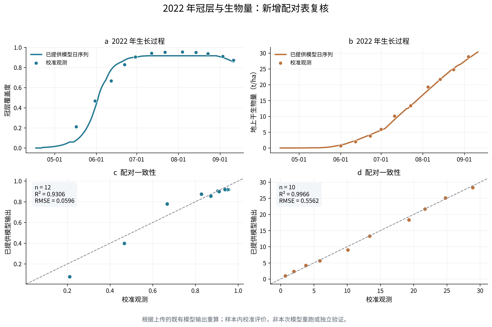
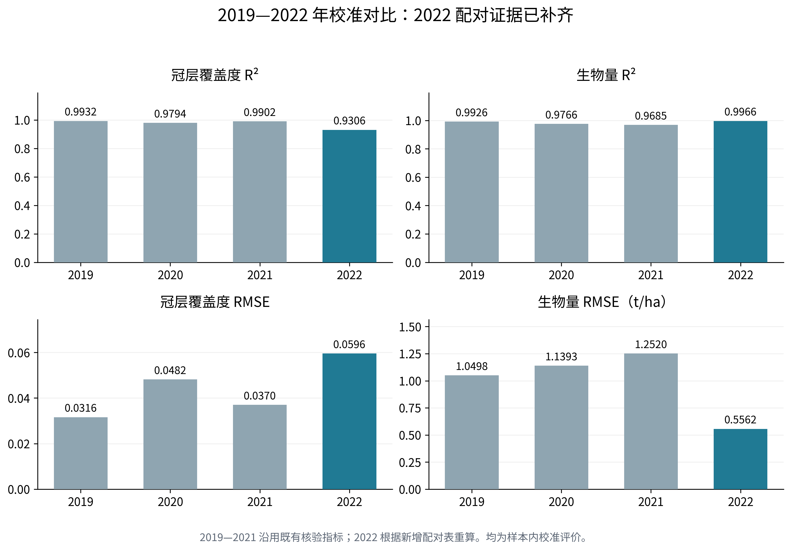

# 2022年新增配对证据与论文增补
版本：2026-10-18。模型源代码已核验，原始运行data未齐；本稿基于上传的既有模型输出复算，真实模型、Sobol和优化本轮未重跑。

## 1 可写入校准结果的新增证据
2022年冠层覆盖度含12条观测—模拟配对，生物量含10条配对。按R²=1−SSE/SST复算，冠层R²为0.930617、RMSE为0.059574；生物量R²为0.996650、RMSE为0.556159 t/ha。模拟配对值与148天日生长输出的对应日期一致。这些为样本内校准评价，不是独立验证或新模型运行。
冠层的Pearson相关平方为0.959224，生物量为0.997228，与1−SSE/SST意义不同。每年仅一组年产量配对，单年产量R²不计算。

图注：曲线和散点源于新提交工作包04_phase2_review中的既有输出与校准观测；本轮重新计算指标并作图。2022年冠层早期存在明显低估，应在讨论中保留。

## 2 四年结果表的更新
2019—2021沿用此前核验指标；2022从文档汇总精度升级为本轮配对复算，生物量样本数补为10。该更新修正10月17日论文中“2022仍缺配对表”的证据状态，不表示本轮重新执行四年作物模型。

| 年份 | CC_R2 | CC_RMSE | 生物量_R2 | 生物量_RMSE_t_ha |
| --- | --- | --- | --- | --- |
| 2019 | 0.993240 | 0.031621 | 0.992644 | 1.049752 |
| 2020 | 0.979361 | 0.048203 | 0.976564 | 1.139319 |
| 2021 | 0.990154 | 0.037038 | 0.968529 | 1.252034 |
| 2022 | 0.930617 | 0.059574 | 0.996650 | 0.556159 |

图注：四年R²按同一定义报告；RMSE保留相应单位。不能用较高生物量拟合优度推断灌溉优化结果已成立。

## 3 原模型复现与后续计算的当前状态
2022原始脚本SHA256为31dc424301d544ca55cbdaf3f68a9b7c265feef2b66f3380f67121232fe954d5，与阶段二科学合同一致。新ZIP漏装其data目录，12份原件中4份已由旧包按哈希恢复，仍缺8份；原模型输入加载首先在B组ETo文件处停止。原清单和原运行合同保留，未生成替代驱动、READY证据或初始参考值。
因此尚不能报告新的真实模型Sobol指数、Pareto前沿、推荐灌水日程或节水率。MCMC保持冻结；四年年度对比表和图均纳入2022。待原始data补齐且基准复现通过，再执行已声明范围的Sobol与固定年度中心的双目标优化及条件扰动核验。
