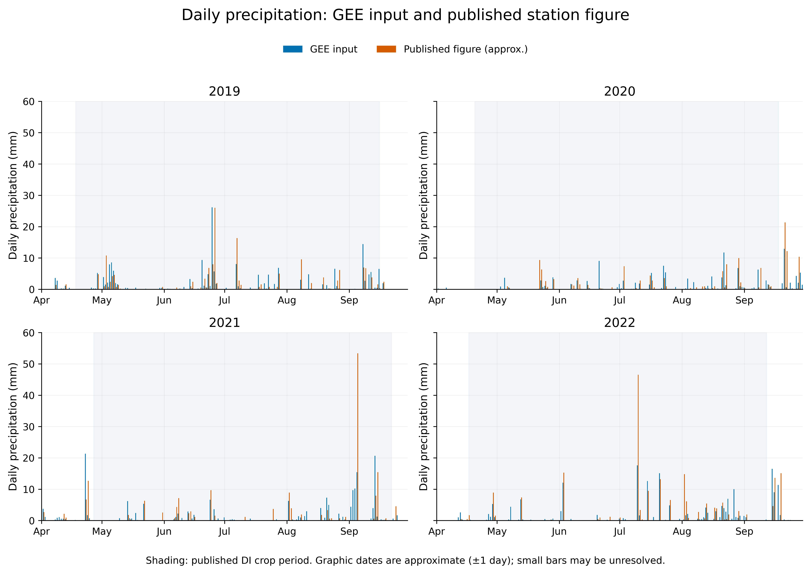
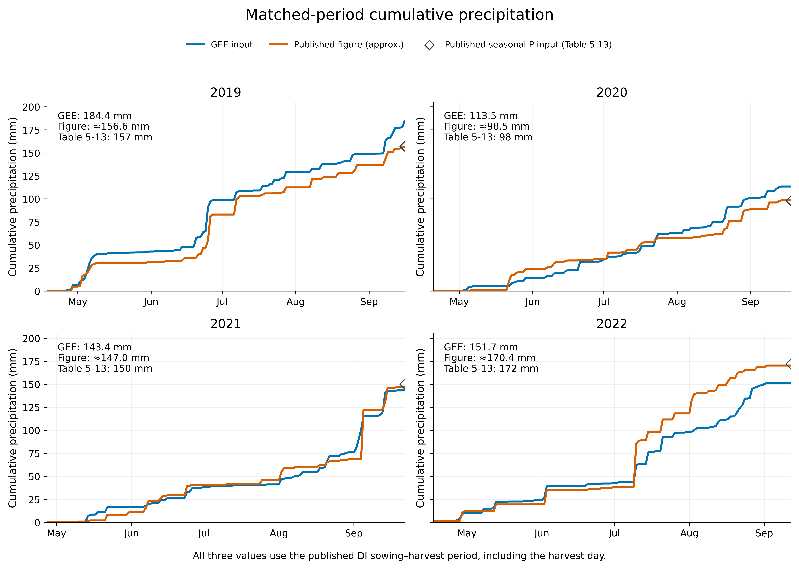

# 四年降水审计与固定参数补充试验（2026-10-21）

已完成224组固定参数回放，未重新校准或优化。原结果和历史六包保留。

- [完整审计压缩包（约23.4 MB）](https://github.com/yuzhenwu920-afk/URP/raw/refs/heads/delivery/urp-review-20261015/deliverables/2026-10-21-rainfall-audit/URP_Rainfall_Audit_20261021.zip)
- [8页Word报告：英文图、中文解析与论文讨论文字](https://github.com/yuzhenwu920-afk/URP/raw/refs/heads/delivery/urp-review-20261015/deliverables/2026-10-21-rainfall-audit/URP_Rainfall_Audit_and_Interpretation_20261021.docx)
- [报告PDF](https://github.com/yuzhenwu920-afk/URP/raw/refs/heads/delivery/urp-review-20261015/deliverables/2026-10-21-rainfall-audit/URP_Rainfall_Audit_and_Interpretation_20261021.pdf)
- [Excel：逐日/季节降水、224组回放与储水账](https://github.com/yuzhenwu920-afk/URP/raw/refs/heads/delivery/urp-review-20261015/deliverables/2026-10-21-rainfall-audit/Rainfall_audit_data_2019_2022.xlsx)

## 主要结论

| 年 | GEE降水 mm | 论文表5-13 DI季节P输入 mm |
|---|---:|---:|
|2019|184.4|157|
|2020|113.5|98|
|2021|143.4|150|
|2022|151.7|172|

比较采用各年论文DI播种—收获期，包含收获日。表5-13的P是论文WHCNS水量平衡输入；ET/E/T/D是模拟结果。未取得原始站点逐日表，逐日对照使用论文图2-2近似重建，已处理2021/2022的断轴并标记±1日读图不确定性。

- 上传CSV与原四年模型气象文件逐字节相同。GEE不是四年一致偏湿，2021总量已经略低。
- 降水替换会影响原候选是否达95%观测产量门槛，但新2021年1m根深模型的350 mm平台仍在；不能以降水解释全部乐观结果。
- fMulch=0.85、原GEE情景中，633.47→350 mm的减灌为283.47 mm，ET仅减少4.12 mm，整个2.4m剖面季末储水减少279.23 mm。减灌不等于耗水减少，固定1m根区与整个剖面不能混用。
- 原前沿可保留为明确输入条件下的探索性潜力；当前不是田间定额验证。下一步优先核对分层土壤含水量、终端库存、胁迫和ET/Es。

ZIP包含8份上传CSV、论文单份PDF、读图证据、4组600dpi英文PNG/PDF/SVG、16页签Excel、224组结果及逐日数据、21组DI与350mm储水差账、Word/PDF、原模型最小依赖、代码和校验清单。未传播完整后验不确定性，2021年500步条件pilot未证明收敛，回放不冒充新Pareto前沿。独立用随包源文件及未加速路径复算28组，主要数值一致。

[来源订正：Es=78 mm是论文报告的观测汇总](ERRATA.md)。GEE产品/ROI/时区仍未核实；遥感CSV的BI标签也需核对。正式解释请阅读报告中的证据边界。

## 四年降水图预览

