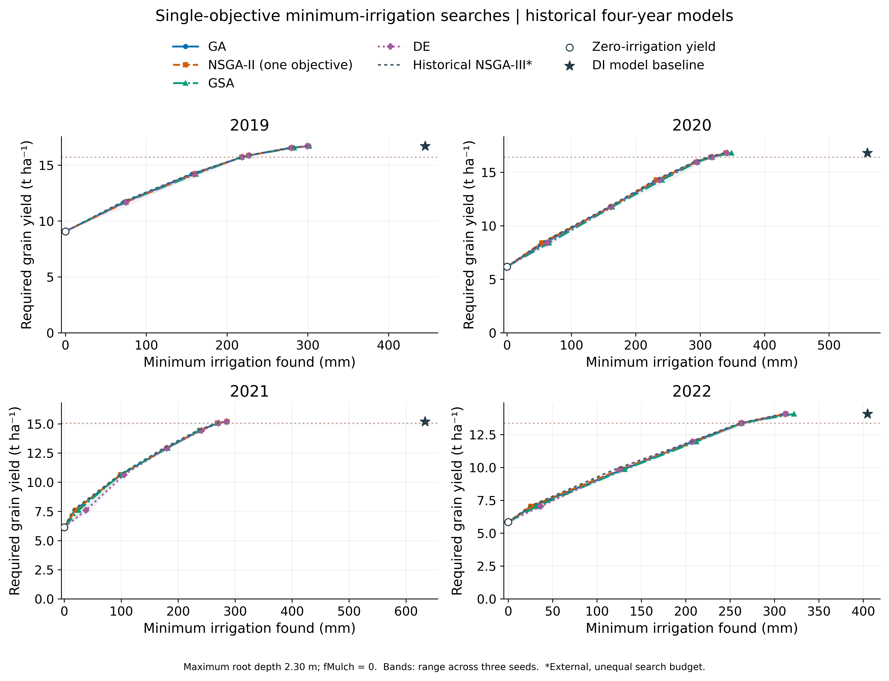
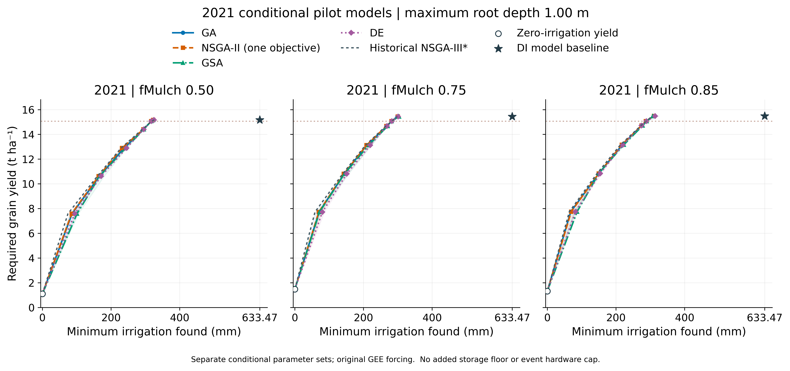
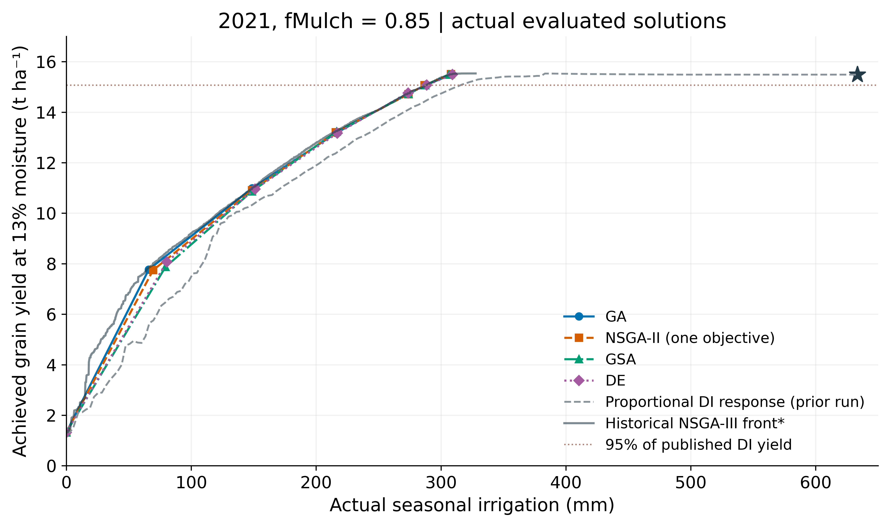

# 单目标最小灌水与多算法验证（2026-10-21）

历史四年模型与最新2021三个fMulch情景分别计算。原文件保留，没有重新MCMC或更改降水。

- [完整工程和全部数据（42.6 MB）](https://raw.githubusercontent.com/yuzhenwu920-afk/URP/refs/heads/delivery/urp-review-20261015/deliverables/2026-10-21-single-objective-comparison/URP_Single_Objective_Comparison_20261021.zip)
- [图件与表格轻量包](https://raw.githubusercontent.com/yuzhenwu920-afk/URP/refs/heads/delivery/urp-review-20261015/deliverables/2026-10-21-single-objective-comparison/URP_Single_Objective_Figures_Tables_20261021.zip)
- [10页Word报告](https://raw.githubusercontent.com/yuzhenwu920-afk/URP/refs/heads/delivery/urp-review-20261015/deliverables/2026-10-21-single-objective-comparison/URP_Single_Objective_Comparison_Report.docx)
- [报告PDF](https://raw.githubusercontent.com/yuzhenwu920-afk/URP/refs/heads/delivery/urp-review-20261015/deliverables/2026-10-21-single-objective-comparison/URP_Single_Objective_Comparison_Report.pdf)
- [13页签Excel](https://raw.githubusercontent.com/yuzhenwu920-afk/URP/refs/heads/delivery/urp-review-20261015/deliverables/2026-10-21-single-objective-comparison/URP_Single_Objective_Comparison_Data.xlsx)

## 本次问题与结果

对一系列产量要求q，单独最小化实际季节灌水量，并约束模型Y13≥q。比较连续实数GA、单目标NSGA-II、广义模拟退火GSA、差分进化DE，三个随机种子，统一初始化、控制域及评价预算。NSGA-II在本轮仅有一个目标。

共253,440次目标查询、217,084次实际优化模型调用；508个不同入选控制使用完整原适配器回放，另有14组原始未加速核验。精确缓存不使用代理或插值。

以下均为95%观测产量门槛，非95%达标概率：

|模型|本轮最低找到灌水 mm|历史NSGA-III档案 mm|
|---|---:|---:|
|old_2019|217.95|218.19|
|old_2020|313.01|312.34|
|old_2021|268.61|267.28|
|old_2022|261.46|260.78|
|new_fm050|316.48|319.11|
|new_fm075|280.15|282.72|
|new_fm085|286.86|287.53|

历史模型根深2.30 m、fMulch=0；最新2021根深1.00 m、fMulch=0.50/0.75/0.85，各自参数不同。覆盖率均75%。未添加终端储水门槛或额外单次设备上限，1m根深模型仍保留2.4m水文域。500步条件pilot未证明收敛。

七组模型与历史NSGA-III档案门槛解的差值为−2.63至+1.33 mm，支持主要权衡关系的数值一致性。历史NSGA-III的预算不同，仅作外部参考，不据此作公平算法效率排名，也不证明全局最优。

最新2021年fMulch=0.85情景，最低找到286.86 mm；减灌346.61 mm中，ET减少17.82 mm、整个剖面季末储水减少327.95 mm。该结果仍依赖库存差异，不能将286.86 mm直接作为已验证田间定额。

完整ZIP包含6组600dpi英文PNG/PDF/SVG、10页Word/PDF与逐图解析、13页签Excel、完整查询记录、种子差异、508控制复算和逐次灌水日程、水量账、代码、原模型最小依赖和逐文件SHA256。原始独立门槛结果、等预算门槛延续结果、方法自身扫描档案最小值分开保存，不以插值补造可行解。

## 图预览

