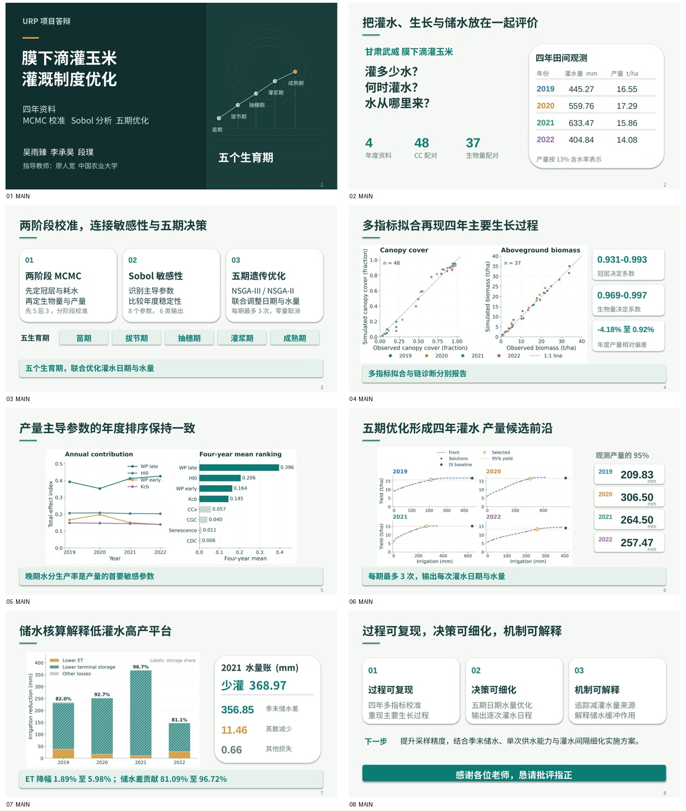

# URP 五分钟答辩：大字精简版（2026-10-25）

**[下载可编辑PPT](URP_Defense_5min_LargeText_20261025.pptx)** · [8页主讲PDF](URP_Defense_5min_LargeText_20261025.pdf) · [完整资料ZIP](URP_Defense_5min_LargeText_Complete_20261025.zip)

已按最新意见删除装饰性英文页眉，页脚仅保留页码；来源说明移入备注。数学上标、帽号等改为普通文字，标题、主要结论和数字放大。8页主讲，建议时间合计300秒；4页隐藏备答，默认放映跳过。主题为最新四年两阶段MCMC、Sobol、五生育期逐次灌水优化与储水机制。全套采用16:9、中文主讲和英文科学图表。

逐页中文讲稿已写入PPT备注：[讲稿Word](URP_5min_Speaker_Script_LargeText_20261025.docx) · [讲稿PDF](URP_5min_Speaker_Script_LargeText_20261025.pdf)。

[含备答的12页PDF](URP_Defense_5min_LargeText_With_Backup_20261025.pdf) · [图表源数据Excel](URP_Defense_Source_Data_20261025.xlsx) · [版面、备注、数据与时间验收](PRESENTATION_QA.json)

主讲用时：15＋35＋40＋45＋35＋50＋55＋25＝300秒；第8页结束即停。备答含原链诊断、逐次灌水日程、三个关键问题、主要文献。完整ZIP含PPT、全部PDF、讲稿、源数据、高清图及生成代码。

科学结果沿用2026-10-23最新论文，模型版本20f1616556f5aeb79329b7ead22faa28f9fcda6a。本次仅制作答辩、重绘图表，无新增模型运行；四年主设定与2021条件试验分开，采样诊断和水量组成如实说明。
