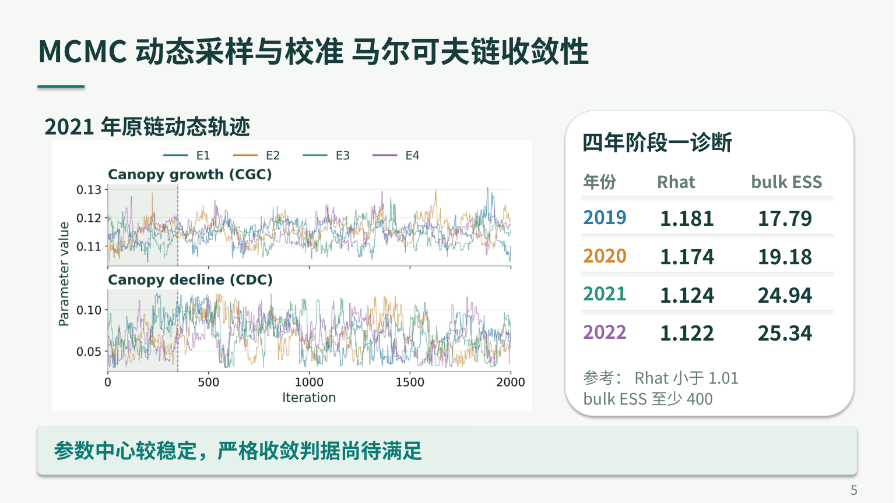

# URP答辩：第4页后新增MCMC收敛性页（2026-10-26）

**[下载新版PPT](URP_Defense_5min_MCMC_20261026.pptx)** · [新增页单页预览](Added_MCMC_Convergence_Page_20261026.pdf) · [9页主讲PDF](URP_Defense_5min_MCMC_20261026.pdf) · [完整资料ZIP](URP_Defense_MCMC_Addition_20261026.zip)

以本次上传的修改版为底稿，原12页正文与原图全部保留。仅在第4页后新增1页，后续4个主讲页码顺延，备注与讲稿时间重新分配。现为9页主讲、4页隐藏备答，建议主讲合计300秒。

新增页展示2021年原始采样轨迹和四年第一阶段Rhat/bulk ESS汇总，明确“参数中心较稳定，严格收敛判据尚待满足”。使用普通字符与大字排版，无新增MCMC计算。

[更新讲稿Word](URP_Defense_Speaker_Script_MCMC_20261026.docx) · [讲稿PDF](URP_Defense_Speaker_Script_MCMC_20261026.pdf) · [含备答13页PDF](URP_Defense_5min_MCMC_With_Backup_20261026.pdf) · [保全与排版核验](PRESENTATION_QA.json)

完整ZIP含上传底稿原字节副本、新版PPT/PDF、讲稿、原链代表轨迹、原诊断汇总、检查点来源哈希、绘图与插页代码。原12页XML按原字节恢复，仅替换旧第5至8页的页码；原有5个媒体文件逐字节一致。
